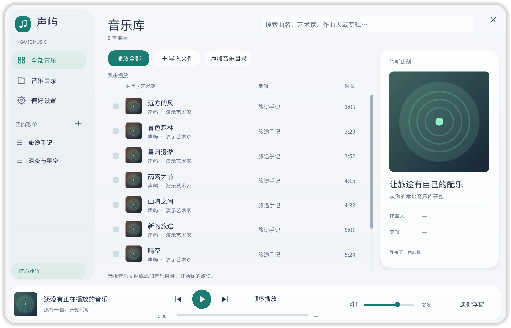
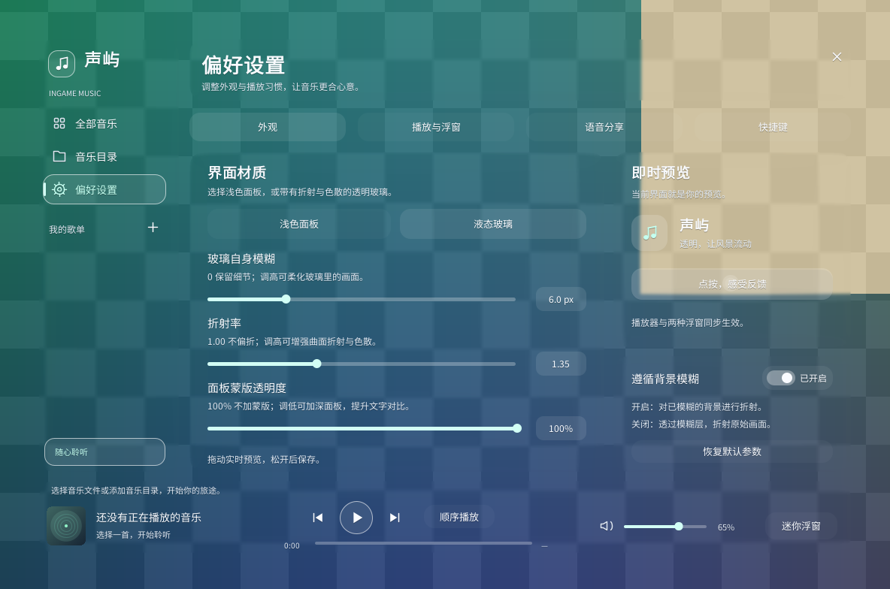
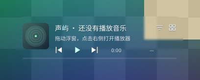
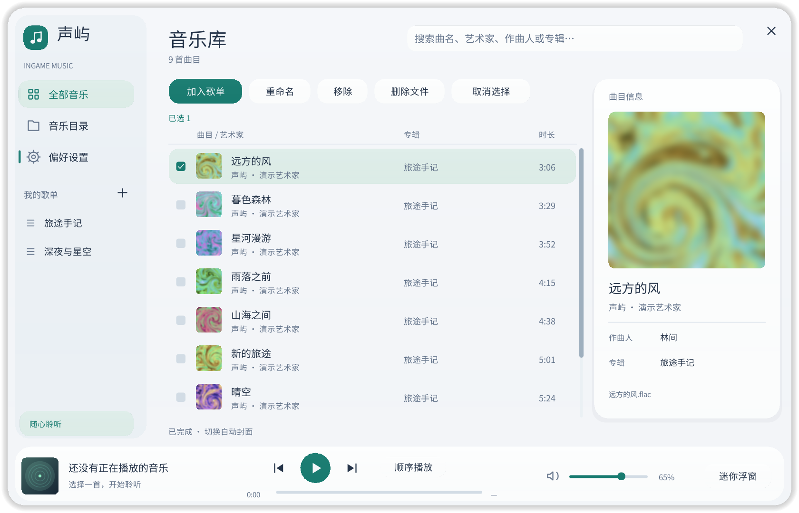

# 声屿 · InGame Music

在 Minecraft 中聆听、整理和分享你的本地音乐。

声屿是一款适用于 **Minecraft 1.21.11 / Fabric** 的纯客户端音乐播放器，支持音乐库、歌单、可拖动浮窗和透明液态玻璃界面。音频解码器随模组提供，无需安装 FFmpeg 或外部播放器，本地播放无需在线服务。



> 本页图片为使用演示内容生成的离屏预览；液态玻璃预览使用程序化背景，并非游戏内截图。

## 功能一览

- **本地音乐库**：导入文件或扫描多个目录，按曲名、艺术家、作曲人、专辑和文件名搜索。
- **歌单与播放控制**：多选整理歌单，支持顺序播放、列表循环、单曲循环、随机播放和进度定位。
- **游戏内浮窗**：完整、简洁两种样式，可拖动、控制播放；操作播放器不会暂停单人世界。
- **透明液态玻璃**：分区面板呈现折射与色散，可调整模糊、折射率和蒙版透明度，主界面与浮窗同步生效。
- **封面与文字**：读取内嵌或目录封面，可为缺失封面的曲目自动生成图案；内置中文和单色 Emoji 字体。
- **可选语音分享**：通过 Simple Voice Chat 将音乐分享给其他玩家，独立调整分享音量。

## 安装

| 环境 | 要求 |
| --- | --- |
| Minecraft | 1.21.11 |
| 模组加载器 | Fabric Loader 0.18.4 或更新版本 |
| Java | 21 |
| 必装依赖 | 对应 Minecraft 1.21.11 的 Fabric API |

1. 准备符合上述要求的 Fabric 游戏实例，并安装 Fabric API。
2. 将模组 JAR 放入该实例的 `mods` 目录，例如 `ingamemusic-1.0.0.jar`。请勿使用 `-sources.jar`；也可[从源码构建](#从源码构建)。
3. 启动并进入游戏，按 **M** 打开播放器。

**服务器无需安装声屿。** Simple Voice Chat 和 IMBlocker 均为可选模组，不影响基础本地播放。

## 快速开始

1. 点击 **导入文件** 选择音乐，或在 **音乐目录** 中添加目录并扫描。文件浏览器支持双击进入文件夹，也可在路径栏粘贴目录路径。
2. 双击曲目或选中后按 **Enter** 播放，使用底部播放条调节音量、切换曲目和播放模式。
3. 点击 **我的歌单** 旁的加号创建歌单，选中曲目后点击 **加入歌单**。
4. 按 **H** 切换浮窗显示，再按 **右 Alt** 操作或拖动。点击浮窗外侧或按 **Esc** 返回游戏。

导入仅记录原文件位置，不会复制音乐。目录扫描包含子目录；音乐文件移动或标签更新后，可重新扫描。播放器音量独立于游戏音量，如需避免与原版背景音乐重叠，可调低游戏设置中的“音乐”音量。

### 默认按键

| 按键 | 功能 |
| --- | --- |
| M | 打开播放器 |
| P | 播放 / 暂停 |
| ] | 下一首 |
| H | 显示 / 隐藏浮窗 |
| 右 Alt | 操作 / 拖动浮窗 |
| 空格 | 在播放器或浮窗操作界面内播放 / 暂停 |
| Esc | 关闭弹窗、取消输入焦点或返回游戏 |

可在 **游戏选项 → 控制 → 按键绑定 → 声屿** 中修改全局快捷键。播放器设置页会显示当前绑定；输入文字时不会触发播放快捷键。

### 整理音乐与文件

使用 **Ctrl / Command + 单击** 多选、**Shift + 单击** 连续选择、**Ctrl / Command + A** 全选当前列表。歌单支持重命名和删除。

| 操作 | 对原文件的影响 |
| --- | --- |
| 从音乐库中“移除” | 仅移除库记录，不删除文件；重新扫描可再次导入音乐库 |
| 从歌单中“移除” | 仅移除该歌单中的引用，不删除文件 |
| F2 / “重命名” | 修改磁盘文件名，保留扩展名与音频标签；同步更新歌单中的路径 |
| Delete / “删除文件” | 确认后移入原目录下的 `.ingamemusic-trash`，同时移除音乐库和歌单记录 |

批量重命名支持 `{name}`（原文件名，不含扩展名）和 `{n}`（从 `01` 开始的序号），例如 `{n} - {name}`；不会覆盖已有文件。恢复已删除文件时，可参考回收目录中的 `.restore.json`，将音频移回原路径并重新导入。目录扫描会跳过回收目录。

## 外观与浮窗

**偏好设置** 分为 **外观、播放与浮窗、语音分享、快捷键** 四页。界面提供简体中文和英文，跟随游戏语言；内置 Noto Sans SC 与 Noto Emoji，无需另行安装字体。Emoji 使用与文字同色的单色字形。

### 液态玻璃

在 **偏好设置 → 外观 → 界面材质** 中选择 **液态玻璃**，即可应用到主界面、弹窗与两种浮窗。透明材质保留背景原色，通过屏幕空间光学近似呈现曲面折射与色散。

| 设置 | 范围 / 默认值 | 效果 |
| --- | --- | --- |
| 玻璃自身模糊 | 0–24 px / 6 px | 调整玻璃内部画面的模糊程度；0 保留背景细节 |
| 折射率 | 1.00–2.00 / 1.35 | 1.00 不偏折，调高增强曲面折射与色散 |
| 面板蒙版透明度 | 0–100% / 100% | 100% 不加蒙版；调低可加深面板、提升文字对比；0% 完全遮住面板后的画面 |
| 遵循背景模糊 | 默认开启 | 开启时折射已模糊的背景；关闭时穿过菜单模糊层，折射模糊前的原始画面 |

想透过玻璃看到清晰的原始画面，可关闭 **遵循背景模糊**，并将 **玻璃自身模糊** 调为 **0**。这些设置实时预览，滑杆松开后保存；关闭液态玻璃会保留参数。



### 浮窗与封面

在 **偏好设置 → 播放与浮窗** 中选择完整或简洁浮窗，也可在浮窗右上角直接切换。浮窗位置会自动保存。

封面优先读取音频内嵌图片，其次查找同目录的 `cover.jpg`、`cover.png`、`folder.jpg` 或 `folder.png`。开启同页的 **自动生成封面** 后，会为缺失封面的曲目生成图案；已有封面优先，生成结果仅保存在缓存中，不会修改音乐文件。此选项默认关闭。

<details>
<summary>更多界面预览</summary>






</details>

## 语音分享（可选）

客户端安装兼容的 **Simple Voice Chat**，并连接支持该模组的服务器后，可在 **偏好设置 → 语音分享** 中开启 **SimpleVoiceChatRedirect**。本地音乐会与麦克风人声混合，按当前附近或群组通道发送，接收范围遵循服务器设置。此功能默认关闭，服务器无需安装声屿。

**语音中的音乐增益**可在 **0–200%** 间调整，默认 **35%**，独立于本地播放和麦克风音量。

**分享音乐无需持续按语音键，麦克风静音也不会停止分享。** 要停止发送音乐，请关闭分享开关、暂停播放、将分享增益设为 0%，或禁用 Simple Voice Chat。

## 支持的音频格式

| 扩展名 | 支持说明 |
| --- | --- |
| `.flac` | FLAC，支持高位深输入，输出转换为 16-bit PCM |
| `.mp3` | MP3 音频 |
| `.aac` | ADTS 封装的 AAC；不支持 `.m4a` / MP4 容器或 DRM |
| `.ogg` / `.oga` | Ogg 容器中的 Vorbis 或 Opus 音频 |
| `.opus` | Opus 音频 |
| `.wav` | PCM 或 Java Sound 可转换的 WAV 音频 |

播放器输出单声道或双声道、16-bit PCM，不支持多声道输出。高采样率支持取决于系统音频设备。定位长文件的后段时可能需要等待解码，界面会显示“加载中”。

曲名、艺术家、作曲人和专辑取自文件标签；缺失标签时使用文件名或未知信息占位。

## 配置与兼容性

配置位于当前游戏实例的 `config/ingamemusic/`：

```text
config/ingamemusic/
├── library.json        # 音乐库、目录、歌单、播放、外观与浮窗设置
└── covers/             # 封面缓存；generated/ 存放自动生成的封面
```

损坏的配置会保留时间戳备份；修复或移走损坏配置后可重新启动。

自绘输入框提供可选的 **IMBlocker** 适配，用于搜索、路径、歌单和重命名输入。

## 从源码构建

准备 **JDK 21**，在项目根目录执行：

```powershell
# Windows PowerShell
.\gradlew.bat build
```

```sh
# Bash / sh
./gradlew build
```

可安装的模组位于 `build/libs/ingamemusic-1.0.0.jar`，所需 Java 音频库已随包提供。更多开发说明见 [开发指南](docs/DEVELOPMENT.md)。

## 反馈与贡献

欢迎通过 [GitHub Issues](https://github.com/Kush-ShuL/InGameMusic/issues) 提交问题或建议。报告问题时，请附上 Minecraft、声屿和 Fabric Loader 版本、操作系统、复现步骤及相关日志；音频问题请同时说明文件格式。

欢迎通过 Pull Request 提交代码改进和翻译。

## 许可证

Copyright (c) 2026 mc_plfd_host。

本项目自有代码与文档采用 **GNU Lesser General Public License v3.0（LGPL-3.0-only）**，详见 [LICENSE](LICENSE) 及其引用的 [GPLv3 全文](COPYING)。第三方音频库、字体等组件遵循各自的许可证，详见 [THIRD_PARTY_NOTICES.md](THIRD_PARTY_NOTICES.md)。
